# Channeling Overhaul — mod design

> Russian translation: [DESIGN.ru.md](DESIGN.ru.md). This English version is the source of truth.

Document version: 29 October 2026

## Overview

The mod turns Channeling from "lightning in a thunderstorm" into a charge mechanic. The trident gathers electricity from its surroundings within a radius set by the enchantment level, and discharges it into the target on hit. The higher the level, the larger the gathering radius, the capacity and the number of chain lightning hops.

**Key decisions:**

- The main charging happens while the trident is stuck in a block. Winding up (holding right click) gives a small top-up in combat.
- The charge is stored in the item itself and slowly leaks, so you can charge at a station and then go fight.
- A throw spends the charge only when it hits a mob. A miss into a block keeps the charge.
- Copper and lightning rods work as an antenna: they multiply the inflow from the sky rather than create charge from nothing.
- If the target stands in water, the discharge spreads to the mobs in that water.

**Stack:**

| Component | Role | Status |
| --- | --- | --- |
| NeoForge | Loader | Required |
| Kotlin for Forge | Mod language (Kotlin) | Required |
| Apothic Enchanting (+ Placebo) | High enchantment levels, enchanting table | Required |
| Apotheosis | Affixes, world tiers | Optional, only for future integration |
| GeckoLib | Animated models | Not needed: all visuals use vanilla particles |

Target version: Minecraft 26.1.2, NeoForge 26.1.2.124, Java 25, Apothic Enchanting 2.1.0 (Placebo 10.0.0, Apothic Attributes 3.0.1). Apothic Attributes 3.0.0 is incompatible with NeoForge 26.1.2.70-beta+: it crashes when a mob is hit (`LivingDamageEvent.Post.getNewDamage` was removed in 26.1.2.70-beta). The logic is written in Kotlin; mixins, if needed, are in Java, because Kotlin mixins are unreliable.

All numbers below are starting values and must live in the server config, not in code.

## Core concepts and formulas

The enchantment level L sets three values: capacity, gathering radius and the number of chain hops. The radius grows as a square root so that at high levels the number of blocks in the sphere (∝ R³) doesn't explode.

**Capacity** (maximum charge):

```
Qmax(L) = 10 + 6·L
```

**Gathering radius** in blocks:

```
R(L) = 2 + 2·√L
```

**Charging** with saturation. I is the inflow in charge units per second (section "Charge sources"):

```
dQ/dt = I · (1 − Q / Qmax),    I = S · A
```

S is the inflow from the sky, A is the antenna multiplier (copper, lightning rods, water). The increment over a step Δt is computed exactly, without accumulating error:

```
Q ← Qmax − (Qmax − Q) · exp(−I · Δt / Qmax)
```

**Leak** outside charging (in the inventory, in hand, in flight): exponential with a half-life T½ = 150 s.

```
Q ← Q · 2^(−Δt / T½)
```

**Discharge damage** to the primary target, M is the target's vulnerability multiplier (section "Discharge and damage"):

```
D = 0.6 · Q · M
```

**Chain hops:** N(L) = min(8, ⌊L / 3⌋).

| Level | Radius, blocks | Capacity | Damage at full charge, M = 1 | Chain hops |
| --- | --- | --- | --- | --- |
| I | 4.0 | 16 | 9.6 | 0 |
| V | 6.5 | 40 | 24 | 1 |
| X | 8.3 | 70 | 42 | 3 |
| XX | 10.9 | 130 | 78 | 6 |
| XXXI | 13.1 | 196 | 118 | 8 |

Filling the "battery" at high levels from the bare sky is slow (XXXI in a thunderstorm: time constant about 130 s). This is intentional: a high level pays off only with infrastructure. Vanilla reference points for balance: a thrown trident deals 8 damage, lightning 5.

## Charge sources

Charge comes only from the sky. Copper, lightning rods and water work as an antenna and multiply this inflow, and a lightning strike nearby gives a large one-off charge.

### Sky (S)

Computed at the trident's position, only if it has open sky above it (`canSeeSky`). The precipitation type is taken from the biome at that point (`Biome.getPrecipitationAt`): rain, snow or none. In biomes without precipitation (desert, savanna) the "Clear" row applies in any weather.

| Weather | S in a rain biome, charge/s | S in a snow biome, charge/s |
| --- | --- | --- |
| Clear | 0.1 | 0.1 |
| Precipitation | 0.5 | 0.35 |
| Thunderstorm | 1.5 | 1.0 |

Snow is dry and conducts worse than rain, but still electrifies the air. Vanilla lightning doesn't strike in snow biomes, so there is no lightning strike bonus there.

Without open sky S = 0, and the antenna is useless.

### Antenna (A)

```
A = min(3, 1 + Σ_copper 0.1·c·p + Σ_k 0.5^k · 0.5·p_k + min(0.3, Σ_water 0.02·p))
```

Here p = 1 − d / R is the block's proximity (1 at the trident, 0 at the edge of the radius), c is the copper conductivity, k is the lightning rod's index by proximity (0, 1, 2…).

**Copper.** Conductivity depends on the oxidation stage; waxed copper keeps its stage:

| Stage | c | 16 blocks around give A ≈ |
| --- | --- | --- |
| Clean | 1.0 | 2.0 |
| Exposed | 0.75 | 1.7 |
| Weathered | 0.5 | 1.5 |
| Oxidized | 0.25 | 1.25 |

The weights are set by a block data map (`conductivity`), to cover all copper variants (cut, grate, bulb, doors, trapdoors) and blocks from other mods without code changes.

**Lightning rod.** The nearest one contributes 0.5·p, each next one half as much; otherwise players would place them by the dozen.

**Water.** Water sources give a small bonus, at most +0.3 in total.

### Lightning strike

Any lightning (`LightningBolt`) striking within radius R of a stuck trident instantly adds charge (the discharge bolt `discharge_bolt` is not a `LightningBolt` and gives no charge):

- into a lightning rod: +50% Qmax;
- anywhere else: +25% Qmax.

This is the main way to fill high levels quickly in a thunderstorm.

How it is done (stage 7):

- `LightningListener` catches a `LightningBolt` when it joins the world (`EntityJoinLevelEvent`, lowest priority). Bolts with `visualOnly` are skipped; the flag is read by the accessor mixin `LightningBoltAccessor`.
- Tridents are looked up in the per-dimension registry of stuck tridents kept by `StuckTridentCharger`: a trident's id is added when it sticks and removed when it leaves the block or the world. Loyalty tridents held in copper are in the registry too.
- The distance is measured from the bolt's position to the trident, at most R(L) of that trident. One bolt charges all tridents within radius, each with its own sparks.
- "Into a lightning rod" means a rod from the `conductivity` data map stands in the block below the bolt or in the bolt's own block:
  - natural lightning lands on the block above the rod;
  - Channeling lightning, when the trident hits a rod, stands in the rod itself.
- A stuck trident doesn't leak, so the bonus is added to the stored charge.

### Examples, Channeling V, 60 seconds

| Conditions | Charge | Damage, M = 1 |
| --- | --- | --- |
| Clear, no copper | 6 | 3 |
| Rain, no copper | 21 | 13 |
| Rain, 16 oxidized copper | 24 | 14 |
| Rain, 16 clean copper | 31 | 18 |
| Thunderstorm, no copper | 36 | 21 + vanilla lightning |

## Charge lifecycle

The charge lives in the item and moves with it between states. It accumulates mostly while the trident lies stuck, and is spent only when it hits a mob.

```mermaid
stateDiagram-v2
    Inventory: In inventory (leak, T½ = 150 s)
    Windup: Windup (top-up to 30% Qmax)
    Flight: Flight (leak, no gathering)
    HitMob: Hit a mob (discharge, Q → 0)
    Stuck: Stuck or lying (main charging; lightning nearby +25–50% Qmax)
    Inventory --> Windup: right click
    Windup --> Flight: throw
    Flight --> HitMob: into a mob
    Flight --> Stuck: into a block
    HitMob --> Stuck: without Loyalty
    HitMob --> Inventory: Loyalty
    Stuck --> Inventory: picked up or Loyalty (no Channeling or the block is not copper or a rod)
```



After a discharge a trident without Loyalty falls to the ground and starts charging again, like a stuck one. A trident with Loyalty returns right after hitting a mob, as in vanilla.

**Rules by state:**

1. **Stuck or lying** (`inGround`, including after bouncing off a mob). Charging by the formula once every 10 ticks, no leak. A lightning strike within radius gives a one-off bonus. A trident returning by Loyalty doesn't count, even if its vanilla `inGround` is still set: that's flight.
2. **Windup** (the player holds right click with the trident). The inflow is computed at the player's position with a factor of 0.5. Windup can't raise the charge above 30% Qmax: if the charge is already higher, windup adds nothing.
   - Sources around the player are scanned at most once per second (`windup.rescanInterval`); between scans the cache is used. Each tick of use is 1/20 s of windup.
   - During the windup the stack in hand doesn't change: the windup accumulates on the server (`WindupState`). Any component change would be synced to the client, and NeoForge plays the "re-equip" animation for any new stack.
   - The charge is written to the stack in `LivingEntityUseItemEvent.Stop`. This event comes before `TridentItem.releaseUsing`, which copies the stack into the thrown trident, so the windup ends up in it.
   - A windup interrupted by a slot change (without releasing right click) is lost: vanilla `stopUsingItem` sends no events.
   - No leak during the windup, as while charging.
3. **Flight.** No gathering, the leak applies.
4. **Hitting a mob.** If Q ≥ 3, the whole charge goes into the discharge. If less, nothing happens and the charge stays.
5. **Hitting a block.** The charge is kept, the trident sticks and starts charging.
6. **Pickup or Loyalty.** The charge moves into the item as is.
7. **Loyalty at a station.** A Loyalty trident stays stuck only if it has Channeling and the block it hit is in the `conductivity` data map as copper or a lightning rod (water doesn't count). Such a trident waits to be picked up by hand, like a trident without Loyalty. In all other cases the vanilla return applies: after 4 ticks in a block, immediately after hitting a mob. If the block under a held trident is broken, the trident falls out and returns.
   - The block is taken from the vanilla arrow field `lastState` (`inBlockState` in NBT), so the hold survives chunk unloading.
   - The client knows neither this block nor the trident's enchantments and doesn't start the return of a stuck trident by itself; it waits for the `noPhysics` flag from the server. Otherwise the client would show a return that doesn't happen on the server.
8. **A stuck Channeling trident doesn't despawn.** A vanilla trident without Loyalty disappears after 1200 ticks (a minute) in a block, and a station wouldn't work longer than a minute. A Channeling trident that can be picked up (`pickup == ALLOWED`: thrown by a player in survival or shot by a dispenser) stays until picked up, like a vanilla Loyalty trident. The others despawn as in vanilla: without Channeling, thrown in creative mode (`CREATIVE_ONLY`) and thrown by mobs (`DISALLOWED`).
9. **Inventory and hand.** Leak with T½ = 150 s. Computed lazily: the component stores the game time of the last update, and the leak is applied on read. No need to tick every item.
10. **Melee** doesn't spend the charge. The charge is spent only when a thrown trident (right click) hits.

Vanilla Channeling lightning in a thunderstorm on hit is kept: it's an effect from the enchantment JSON and doesn't depend on the charge.

## Discharge and damage

On hitting a mob the whole charge goes into the discharge: the primary target takes D = 0.6·Q·M, then the discharge hops along a chain, and if the target is in water, it also spreads through the water.

### Target vulnerability (M)

M = min(2, 1 + Σ armor bonuses + wet target bonus). The bonuses are set by an item data map (`armor_conductivity`), to support armor from other mods. All armor slots count (`EquipmentSlot.isArmor`), including the body slot of animals. Horse armor isn't in the data map, so it gives 0.

| Condition | Bonus to M |
| --- | --- |
| Gold armor piece | +0.15 per piece |
| Copper armor piece (1.21.9+) | +0.15 per piece |
| Netherite armor piece | +0.12 per piece |
| Iron or chainmail armor piece | +0.10 per piece |
| Leather, diamond, turtle shell | 0 |
| Target is wet (`isInWaterOrRain`: in water, including a bubble column, or in rain; there is no `isInWaterRainOrBubble` in 26.1) | +0.25 |

Examples: a full iron set gives M = 1.4, a full gold set on a wet target 1.85.

### Chain

1. The primary target takes D.
2. The discharge looks for the nearest not yet hit target within 4 blocks. If the candidate has M > 1 (metal or wet), the reach to it is 6 blocks.
3. Each hop takes 0.6 of the previous hop before multiplying by M, and M applies only to its own target: D_n = 0.6 · Q · 0.6ⁿ · M_n (n = 0 is the primary target). This way M doesn't accumulate along the chain, and a chain through mobs in metal armor fades out rather than grows.
4. At most N(L) = min(8, ⌊L / 3⌋) hops. The chain breaks if there is no suitable target.
5. Hops come with a 2-tick delay, so the chain can be seen.
6. Excluded: the owner, their tamed animals, players when PvP is off on the server, and team allies (scoreboard teams), mobs with the tag `channeling_overhaul:discharge_immune`. With PvP on, the chain hits players by default, config option `chainHitsPlayers = true`.

Example for D = 24: 24 → 14 → 9 → 5.

**How it is done (stage 6):**

- Distances are measured between the centers of the entities' bounding boxes.
- Besides the exclusions of item 6, the chain and the water don't hit spectators, armor stands and those invulnerable to this damage (for example, a player in creative mode).
- The `discharge_immune` tag is empty by default.
- The player rules (PvP, `chainHitsPlayers`) apply to a player's trident. A drowned's trident always hits players, as a normal mob attack.
- `ChainScheduler` keeps only entity ids, the owner's and trident's UUIDs and the last link's position:
  - if a link died or vanished between hops, the chain continues from where it was last seen;
  - if the owner left the server, the discharge plays out without an attacker.
- The delay between hops is in the config: `chain.hopDelayTicks = 2`.
- One shared "already hit" list for the whole discharge: the primary target, the water and the chain. Each entity takes at most one hit.

### Water spread

If the primary target is in water (`isInWater`), the discharge also hits all living entities in water within radius r_w = min(8, 3 + L / 5):

```
D_water = 0.4 · 0.6 · Q · (1 − d / r_w) · M
```

The water is computed from the base 0.6·Q, not from the primary target's D, and M applies only to its own target, as in the chain. Otherwise the primary target's M and the water target's M would multiply: two wet targets would give ×1.56.

- The spread fires only from the primary target. Chain targets in water don't spread again, otherwise the damage multiplies like an avalanche.
- The "same water body only" mode (flood fill up to 512 water blocks from the target) is a config option, off by default. By default it's enough for an entity to be in water and within radius.
- How it is done (stage 6):
  - the water hits immediately, in the same tick as the main discharge; the chain starts 2 ticks later and skips those the water hit;
  - config options: `waterSpread.sameWaterBody` and `waterSpread.floodLimit = 512`.

### Damage type and side effects

- Three own damage types — `discharge` (main discharge), `discharge_chain` (chain), `discharge_water` (water) — are defined as data, for example: `data/channeling_overhaul/damage_type/discharge.json` with the fields `message_id` (`channeling_overhaul.discharge`), `exhaustion` (0.1) and `scaling` (`when_caused_by_living_non_player`).
- The types are added to the tag `data/minecraft/tags/damage_type/is_lightning.json`: mods with lightning protection usually check this tag and automatically protect from the discharge too.
- Two more tags:
  - `minecraft:bypasses_cooldown`: the discharge comes in the same tick as the trident's hit. Without the tag the vanilla invulnerability after a hit would count only the part of D above the trident's 8 damage, and a discharge up to 8 would deal nothing.
  - `minecraft:no_knockback`: the trident has already knocked the target back; a second push would double the knockback.
- The discharge fires only if the trident's hit went through. If the damage was blocked by a shield, canceled by PvP settings or a team alliance, or the target is invulnerable, the charge stays in the trident.
- Apothic Attributes rolls crits on any damage with a living attacker, unless the damage type is in the tag `apothic_attributes:cannot_critically_strike`. A player's base chance is 5%, crit damage ×1.5. The discharge crits too, as "damage affixes work" promises. If this is unwanted, it's enough to add the three types to that tag.
- Damage is dealt through `DamageSource(type, trident, owner)`: the kill is credited to the player, Apotheosis damage affixes work, armor reduces the damage as for normal lightning.
- Don't spawn a real `LightningBolt` for damage: it sets fires, turns villagers into witches, pigs into piglins, etc.
- The visual lightning on a strong discharge (Q ≥ 50% Qmax) is an own entity `channeling_overhaul:discharge_bolt` (`DischargeBolt`), not a `LightningBolt`. A vanilla one with `setVisualOnly(true)` doesn't fit: in 26.1 that flag removes only fire and `thunderHit`, while the bolt still thunders for all clients within 16 chunks, powers a lightning rod and cleans the copper in the block it strikes.
- The own entity:
  - no damage, fire, effect on copper and lightning rods, and no sound;
  - lives 8 ticks, isn't saved, is tracked by clients like the vanilla one (16 chunks);
  - the client draws it with the vanilla zigzag;
  - it isn't a `LightningBolt`, so `LightningListener` (stage 7) doesn't see it and needs no separate filter.

### Death messages

`%1$s` is the victim, `%2$s` the killer, `%3$s` the item name. The strings are needed in `en_us.json` (required) and `ru_ru.json`.

| Case | Key | Russian | English |
| --- | --- | --- | --- |
| Main discharge | `death.attack.channeling_overhaul.discharge.player` | %1$s был заземлён трезубцем %2$s | %1$s was grounded by %2$s's trident |
| Named trident | `….discharge.item` | %1$s был заземлён трезубцем %2$s «%3$s» | %1$s was grounded by %2$s using %3$s |
| Chain | `….discharge_chain.player` | %1$s оказался следующим звеном в цепи %2$s | %1$s became the next link in %2$s's chain |
| Water | `….discharge_water.player` | %1$s принял электрическую ванну от %2$s | %1$s took an electric bath courtesy of %2$s |
| Full charge, Q ≥ 90% Qmax | `….discharge.overcharged` | %1$s испарился в разряде %2$s | %1$s was vaporized by %2$s's discharge |
| Target in metal armor | `….discharge.conductor` | %1$s забыл, что металл проводит ток | %1$s forgot that metal conducts electricity |
| No killer | `death.attack.channeling_overhaul.discharge` | %1$s был заземлён | %1$s was grounded |

The normal variants work through the damage type's `message_id`. "Full charge" and "metal armor" need an own `DamageSource` subclass overriding `getLocalizedDeathMessage`; priority: full charge, then metal, then the normal variant. The Russian strings use masculine forms, as the vanilla Russian translation does.

The chain and the water have base keys without a killer too: "%1$s became a link in an electric chain" («%1$s оказался звеном электрической цепи») and "%1$s took an electric bath" («%1$s принял электрическую ванну»).

**Who sees them.** Vanilla shows a player's death to everyone, and a tamed pet's death to its owner. No one sees the death of other mobs. The config option `discharge.deathMessages` for deaths from our three damage types:

| Mode | Who else sees it |
| --- | --- |
| `vanilla` | no one |
| `named` (default) | all players, if the mob has a name or is tamed (pets, horses) |
| `all` | all players, for any mob |

- The gamerule `show_death_messages` turns everything off; the mod doesn't duplicate player deaths.
- A pet's owner doesn't get the message twice. NeoForge in `TamableAnimal.die` tells the owner after `LivingDeathEvent`, so the mod skips them exactly when vanilla will do it (the pet is a `TamableAnimal`, the owner is on the server).

> **Verified in 26.1.2.** The death message path: `CombatTracker.getDeathMessage` → `IDeathMessageProvider.DEFAULT` (NeoForge) → `DamageSource.getLocalizedDeathMessage`. How vanilla builds the keys:
> - with an attacker, the base key is used with arguments (victim, killer);
> - `.item` takes the item from the attacker's hand, not the thrown trident;
> - `.player` is used only when there is neither an attacker nor a direct entity.
>
> The discharge always has a direct entity (the trident), so `DischargeDamageSource` chooses the keys:
> - with a killer — `.player`;
> - with the thrown trident's name — `.item`;
> - without a killer — the base key through vanilla logic.
>
> The table above works as is.

## Charging station

A station is a place where the trident is stuck to charge: open sky, waxed copper around, a lightning rod nearby. The mod adds no separate station block; it's built from vanilla blocks.

Example for Channeling V (R ≈ 6.5), top view:

```
  ~ ~ ~ ~ ~ ~ ~      #  waxed copper
  ~ # # # # # ~      I  lightning rod on a pillar (to the side, so it doesn't block the sky)
  ~ # # # # # ~      x  the trident is stuck here
  ~ # # x # # I      ~  water moat (small bonus)
  ~ # # # # # ~
  ~ # # # # # ~
  ~ ~ ~ ~ ~ ~ ~
```

Expected effect: 24 copper blocks together with the lightning rod and the water hit the cap A = 3. In rain Channeling V charges almost fully in about a minute; in a thunderstorm one strike into the rod gives +20 charge at once.

For high levels the station grows: radius XX ≈ 11 blocks, XXXI ≈ 13. Hitting the cap A = 3 takes about 30 closely placed copper blocks, so building huge fields is pointless; the sensible thing is to place copper densely around the point and wait for a thunderstorm.

## Visuals and sound

All visuals are built from vanilla particles and sounds; GeckoLib isn't needed.

| What | How it looks | Implementation |
| --- | --- | --- |
| Charge gathering | Sparks fly from copper, lightning rods and the sky to the stuck trident | Client: "sparks in transit" `electric_spark` fly to the trident over ~10 ticks; the client finds the sources itself from nearby blocks, rate ∝ inflow |
| Charge level | The trident glows brighter as it charges | Item model property by Q / Qmax (26.1: own numeric property + `range_dispatch`), 4 steps |
| Hint | "Charge: 23 / 40" in the tooltip | `ItemTooltipEvent` or the component's `TooltipProvider` |
| Full charge | A short chime and a burst of sparks | Sound `block.amethyst_block.chime`, particles |
| Windup | Sparks at the trident in hand while the windup adds charge | Client, by the player flag `windup_sparks` from the server |
| Chain arc | A thin zigzag between targets | Client: `electric_spark` along a polyline bent up to ±0.35 blocks, 4 ticks, a new zigzag each tick; can later be replaced by an own renderer |
| Strong discharge | A vanilla lightning zigzag from the target upward, without damage, fire or thunder | Own entity `discharge_bolt` for 8 ticks at Q ≥ 50% Qmax; `DischargeBoltRenderer` passes its seed to the vanilla `LightningBoltRenderer`, the geometry isn't copied |
| Water spread | A flash on the water surface | `electric_spark` + `bubble` at the targets' points |
| Chain hop sound | A quiet crackle | `entity.lightning_bolt.impact`, volume 0.3, pitch 1.6 |

How it is done (stage 8):

- **What is computed where.** The computation stays on the server; the client draws the particles.
  - The server tells the client the state of a stuck trident through the data attachment `station` with `.sync()`: charge, Qmax, R, inflow I and antenna A.
  - It's sent only on a noticeable change: the first time, the charge moved by 1% Qmax, the inflow by 5%, or the "full" mark (99.5% Qmax) was crossed. When the trident leaves the block, the state is removed.
  - Arcs and water hits are sent by the server in the packet `channeling_overhaul:sparks`: where to draw, not how much.
  - The sync and the packet go only to clients that have the mod's channel. A client without the mod or a test connection simply doesn't get them, and NeoForge doesn't crash.
- **Charge gathering.** Only for tridents within 32 blocks of the player.
  - The rate is 6 sparks per second per 1 charge/s of inflow, at most 30 per second.
  - The share of sparks from copper and lightning rods is (A − 1) / A, the rest fly from the sky.
  - The client scans the sources itself by the `conductivity` data map and caches them for 5 s.
  - Vanilla `electric_spark` lives 2–3 ticks, so a "spark in transit" moves every tick and leaves a new particle.
- **Full charge.** When the synced charge crosses the "full" mark, the client plays the chime and the burst of sparks once. A trident that first comes into view already full doesn't chime.
- **Item glow.**
  - `channeling_overhaul:charge` = Q / Qmax, 1 for a full trident. In `assets/minecraft/items/trident.json` one of four textures is laid over the vanilla sprite at the marks 0.25 / 0.5 / 0.75 / 1.0.
  - The textures are stubs and can be redrawn: `assets/channeling_overhaul/textures/item/trident_charge_1.png` … `_4.png`.
  - The glow is visible where vanilla draws the flat sprite: inventory, dropped item, item frame, shelf. In hand vanilla draws the 3D model with a special renderer, and the model property doesn't affect it.
- **Sounds** are registered as own `SoundEvent`s pointing to vanilla ones in `sounds.json`, with en_us and ru_ru subtitles:
  - `trident.full_charge` → `block.amethyst_block.chime`;
  - `discharge.chain` and `discharge.weak` → `entity.lightning_bolt.impact`;
  - `discharge.horn` → `item.trident.thunder`;
  - `discharge.distant_thunder` → `entity.lightning_bolt.thunder`.
- **Particles in the client config:** `particles = all / reduced / minimal` (×1 / ×0.4 / ×0.1). Particles go through vanilla `addParticle`, so the vanilla "Particles" setting thins them out on top.

**The "horn" sound** (`item.trident.thunder`) is part of the vanilla Channeling effect and plays as usual in a thunderstorm. For a discharge from 50% Qmax the mod plays the same sound, with the volume growing with Q / Qmax; weak discharges give only a crackle. If the vanilla thunderstorm effect fired at the same moment, the own horn isn't played, so the sound isn't doubled. The own discharge bolt isn't placed then either: the vanilla one has already struck the target, and a second would repeat the zigzag. The fired effect is recognized by a new (`tickCount == 0`) `LightningBolt` at the target. The discharge has no other sounds: only the horn or the crackle. The horn and crackle volumes are in the server config, section `sound`. The sound is played from the server at the hit point (`level.playSound` with `player = null`), so all players nearby hear it. Hearing range ≈ 16 blocks × volume; the volume 1 + 4·Q/Qmax gives 16 to 80 blocks, like the vanilla horn (volume 5). The chain hop crackle stays quiet (0.3) and is heard only up close.

Config option `distantThunder` (off by default): a full discharge at level XX and above additionally plays a distant thunderclap heard across almost the whole dimension, like real lightning. "Full" here means Q ≥ 90% Qmax, the same threshold as "vaporized": the charge leaks in flight, and exactly Qmax never reaches the target. The level is set in `sound.distantThunderMinLevel = 20`. The sound plays at volume 10 000, that is, over 160 000 blocks.

Own `SoundEvent`s are registered right away with vanilla sounds by default, so they can later be replaced by a resource pack without code changes.

## Technical implementation

All game math lives in pure Kotlin functions without Minecraft dependencies, and event handlers only gather inputs and apply the result. This way the formulas can be covered by unit tests and the balance tuned without launching the game.

Event and method names below are given for NeoForge 1.21.x. Before implementing they must be checked against the target version: in 26.1 part of the API was renamed.

### Components

| Component | Responsibility | Mechanism |
| --- | --- | --- |
| `ChargeMath` | Qmax, R, inflow, charging, leak, damage, M, number of hops | Pure functions, parameters from the config |
| `ChargeData` | Charge in the item: `charge: Float`, `lastGameTime: Long` | `DataComponentType` with codec and stream codec, registered through `DeferredRegister.DataComponents` |
| `StuckTridentCharger` | Charging a stuck trident once every 10 ticks | `EntityTickEvent.Post` for `ThrownTrident` in the in-ground state, server only |
| `SourceScanner` | Finding copper, lightning rods, water within radius | Cache on sticking, rescan every 5 s; blocks through the `conductivity` data map |
| `WindupCharger` | Top-up on windup to 30% Qmax | `LivingEntityUseItemEvent` `Start` / `Tick` / `Stop` for the trident; the windup accumulates in `WindupState` and is written to the stack on `Stop` |
| `LightningListener` | One-off bonus on a lightning strike nearby | `EntityJoinLevelEvent` for `LightningBolt` (without `visualOnly`, `LightningBoltAccessor`) + the per-dimension registry of stuck tridents in `StuckTridentCharger` |
| `DischargeHandler` | Discharge on hitting a mob; on a miss, a shield block and a damage refusal the charge stays | Java mixin in `ThrownTrident.onHitEntity` after `doPostHurtEffects`: the code gets there only if the trident's damage went through (`ProjectileImpactEvent` fires before the damage and doesn't know if it went through) |
| `ChainScheduler` | Chain hops with a 2-tick delay | Task queue on `ServerTickEvent.Post`; a task holds only ids, UUIDs and a position |
| `WaterSpread` | Spread through water from the primary target | Entity search by AABB + `isInWater`; water body flood fill behind a config option |
| `DischargeTargets` | Whom the chain and the water may hit, the target's M | Exclusions from the "Chain" section, `armor_conductivity` |
| `DeathAnnouncer` | Death messages of mobs killed by a discharge to all players | `LivingDeathEvent` (lowest priority), option `deathMessages` |
| `DischargeBolt` | Visual lightning of a strong discharge | Own entity `discharge_bolt`: no damage, fire or sound, 8 ticks, not saved. Client: `DischargeBoltRenderer` draws it with the vanilla `LightningBoltRenderer` |
| `StationSync` | What the client knows about a stuck trident | Data attachment `station` with `.sync()`, only on a noticeable change (`Visuals.needsSync`) |
| `ClientStationEffects` | Gathering sparks, full charge chime, windup sparks | `ClientTickEvent.Post`, tridents within 32 blocks, own source cache |
| `ClientSparks` | Chain arcs and water hits | Packet `SparksPayload` from the server, particles by the client config |
| `ChargeGlowProperty` | Item glow | Own numeric property `channeling_overhaul:charge` + `range_dispatch` |
| `ModConfig` | Numbers from this document (`ChargeParams`) and switches (`DischargeRules`: `chainHitsPlayers`, `sameWaterBody`, `deathMessages`); debug flag `debug.dischargeChat`: Q, M and D of each discharge, base, M and D of each hop and water hit, lightning bonus and windup result in the owner's chat | `ModConfigSpec`, server config |
| Data | Override of `channeling.json`, data maps, tags, damage types | Data pack built into the mod in `src/main/resources/data` |

### Charge storage

- The charge is stored in the trident's `ItemStack`. A flying and a stuck trident holds a copy of the stack (`getPickupItemStackOrigin()` / the stack field in `ThrownTrident`); charging writes to it, and on pickup the charge moves into the inventory by itself.
- The leak in the inventory is computed lazily: on every read of `ChargeData` 2^(−Δt / T½) is applied from `lastGameTime` to the current `gameTime`, then the time is updated. No need to tick inventories.
- If the stack can't be reached through public API, an accessor mixin is needed, in Java.

### Enchantment

Verified against the sources of Apothic Enchanting 2.1.0 (26.1 branch): without configuration Channeling keeps a maximum of **I**. For enchantments with vanilla `max_level: 1` Apothic Enchanting doesn't raise the level automatically (`ApothicEnchanting.computeDefaultMaxLevel` returns 1 right away). So the mod configures two files.

**1. `data/apothic_enchanting/data_maps/enchantment/enchantment_info.json`** — Apothic Enchanting's data map. Data map files from different data packs are merged, so our file with one entry doesn't overwrite Apothic's entries. Fields (`EnchantmentInfo.java`): `max_level` (1–127), `max_loot_level`, `max_anvil_combine_level`, `level_cap`, `min_power`, `max_power`.

```json
{
  "values": {
    "minecraft:channeling": {
      "max_level": 31,
      "max_loot_level": 1,
      "level_cap": 31,
      "min_power": { "type": "expression", "expression": "IF(x <= 25, 4 * x, 100 + 15 * (x - 25))" }
    }
  }
}
```

**2. `data/minecraft/enchantment/channeling.json`** — the vanilla enchantment file. `max_level` is raised to 31; the vanilla effects (lightning in a thunderstorm, lightning rod) are kept. `min_cost` / `max_cost` are set linear with a non-zero `per_level_above_first`, so vanilla calculations don't break (the table's power is set by `min_power` from the data map anyway).

What's important to know:

- Table: the top slot gets level = Eterna, power = Eterna × a random multiplier from Quanta, at most 200. Level L is available at power ≥ `min_power(L)`. Without an own `min_power` the default formula (25 + 15·(L−1)^1.6) gives at most Channeling V from the table.
- The chosen formula: up to XXV power = 4·L (the level grows with Eterna), after that 100 + 15·(L−25). Reference points: V — 20, X — 40, XX — 80, XXV — 100, XXX — 175 (maximum Eterna and a lucky Quanta), XXXI — 190 (practically only by anvil: XXX + XXX).
- The anvil doubles the cost for each level (N + N → N+1), so the main path is the table, and the anvil only for the last 1–3 levels.
- `IF` is supported (verified at stage 3): Apothic Enchanting evaluates formulas with EvalEx 2.x, repackaged in Apothic Attributes (`dev.shadowsoffire.apothic_attributes.repack.evalex.Expression`). It has `IF(cond, a, b)` and comparison operators.
- Since 2.1.0 Enchantability gives a chance of +1 level above `max_level`; `level_cap: 31` keeps it from going past XXXI.
- The vanilla `max_level` = 31 matches the data map: levels II–XXXI have no "above maximum" highlight, level I shows as "Channeling I". `max_level` and `max_loot_level` are still set explicitly in the data map: without them Apothic Enchanting would compute the maximum from the table power (it can exceed 31), and loot would take the vanilla 31.
- The level is read in code through `EnchantmentHelper.getItemEnchantmentLevel(holder, stack)`, the holder comes from the `Registries.ENCHANTMENT` registry by `Enchantments.CHANNELING`.

### Performance

- No full sweep of the sphere every tick. At R = 13 the sphere has about 9 000 blocks: scan once on sticking and then every 5 s, or a random sample of 64 positions every 10 ticks.
- The radius in code is capped by a config value (16 by default).
- Charging and source search are server only; the client gets the resulting charge and draws the particles itself.

### Kotlin for Forge

- The main class is a `@Mod object`; event buses through `MOD_BUS` and `FORGE_BUS` from `thedarkcolour.kotlinforforge.neoforge.forge`.
- Subscribers can be written as `@EventBusSubscriber object` with `@SubscribeEvent` and `@JvmStatic`.
- Mixins are Java only, in `src/main/java`.

### Proposed package structure

```
com.equi.channelingoverhaul
├── ChannelingOverhaul.kt      // @Mod object, registration
├── config/ModConfig.kt
├── core/ChargeMath.kt         // pure formulas + tests
├── data/ChargeData.kt         // DataComponent
├── registry/                  // components, sounds, damage types, data maps
├── charge/                    // StuckTridentCharger, WindupCharger, SourceScanner, LightningListener
├── discharge/                 // DischargeHandler, DischargeBolt, ChainScheduler, WaterSpread
├── network/SparksPayload.kt    // arcs and water hits for the client
└── client/                    // ClientStationEffects, ClientSparks, ChargeGlowProperty, DischargeBoltRenderer
```

## Work plan and open questions

Work should go in stages so that after each one the mod starts and shows something in game.

### Stages

- [x] **0. Skeleton.** NeoForge + Kotlin for Forge project, dependency on Apothic Enchanting and Placebo, empty `@Mod object`, the mod starts in the dev environment.
- [x] **1. Formulas.** `ChargeMath` + `ModConfig` + unit tests for all formulas and tables of this document.
- [x] **2. Charge in the item.** `ChargeData`, lazy leak, "Charge: X / Y" tooltip, debug command to give charge.
- [x] **3. Enchantment override.** `channeling.json` with a new `max_level`, Apothic Enchanting data map, checking that the table gives high levels.
- [x] **4. Charging a stuck trident.** Sky + `SourceScanner` + `conductivity` data map.
- [x] **5. Discharge.** `DischargeHandler`, damage types, vulnerability M, keeping the charge on a miss.
- [x] **6. Chain and water.** `ChainScheduler`, `WaterSpread`, exclusions (owner, pets, PvP).
- [x] **7. Lightning and windup.** `LightningListener`, `WindupCharger`.
- [x] **8. Visuals and sound.** Gathering particles, arcs, glow, sounds.
- [ ] **9. Balance.** *Deferred until player feedback.* Playtest at levels I, V, X, XX, XXXI, tuning the numbers in the config. Release 0.1.0-beta ships with the starting numbers of this document.

### Future improvements

Not part of stages 0–9, decided after balance.

1. **Thunder pedestal** — a GeckoLib block into which the trident is inserted with right click.
   - Charging runs on the block tick through `ChargeMath` and `SourceScanner`, like a stuck trident. Open sky is required.
   - A bonus to choose: the pedestal works as a lightning rod or raises the antenna cap A from 3 to 4.
   - Only the owner can take the trident.
   - Coil and glow animation by Q / Qmax.
   - Related idea: the lightning bonus depends on distance, like the copper contribution. Right next to a lightning rod +50% Qmax, toward the edge of radius R the bonus drops to +15%. Currently the bonus is the same within R; that doesn't change.
2. **Chain branching.** With some chance the discharge splits into 2–3 branches in different directions, with at least 90° between branches.
   - The total number of targets stays N(L).
   - A branch's base is multiplied by 0.8.
   - The form (an Apotheosis affix or a separate enchantment I–III) is decided later.

### Open questions

- What will the new trident model look like?

### Decided

- **Version:** Minecraft 26.1.2. Apothic Enchanting 2.1.0 for 26.1.2 was released on 6 October 2026 (stable, not beta).
- **Melee** doesn't spend the charge. The charge is spent only when a thrown trident (right click) hits a mob.
- **Riptide stays incompatible with Channeling.** A Riptide trident isn't thrown and doesn't stick, so the charge mechanic doesn't work with it. A "thunder dash", if needed, is a separate enchantment.
- **PvP:** with PvP on, the chain hits players by default and doesn't touch team allies; turned off in the config (`chainHitsPlayers`).
- **The discharge's visual lightning** is an own entity `discharge_bolt`, not a `LightningBolt` with `setVisualOnly`: the vanilla one would thunder for 16 chunks and change copper and lightning rods (section "Damage type and side effects").
- **Snow** charges weaker than rain (0.35 / 1.0 versus 0.5 / 1.5); biomes without precipitation behave as clear weather.

### Links

- [Kotlin for Forge](https://github.com/thedarkcolour/KotlinForForge/)
- [Apotheosis](https://github.com/shadows-of-fire/apotheosis)
- [Apothic Enchanting (GitHub)](https://github.com/Shadows-of-Fire/Apothic-Enchanting)
- [Apothic Enchanting on Modrinth](https://modrinth.com/mod/apothic-enchanting)
- [Apotheosis on Modrinth](https://modrinth.com/mod/rqFWfVlz)
- [NeoForge: 26.1 announcement](https://neoforged.net/news/26.1snapshots/)
