# Channeling Overhaul — дизайн мода

> Перевод. Основная версия — [DESIGN.md](DESIGN.md) (английский); при расхождении верна английская.

Версия документа: 29 октября 2026

## Обзор

Мод превращает Channeling из «молнии в грозу» в механику накопления заряда: трезубец собирает электричество из окружения в радиусе, зависящем от уровня чар, и разряжает его в цель при попадании. Чем выше уровень, тем больше радиус сбора, ёмкость и число прыжков цепной молнии.

**Ключевые решения:**

- Основная зарядка идёт, пока трезубец воткнут в блок. Замах (зажатая ПКМ) даёт небольшую подзарядку в бою.
- Заряд хранится в самом предмете и медленно утекает, поэтому можно зарядиться на станции и идти в бой.
- Бросок тратит заряд только при попадании в моба. Промах в блок заряд сохраняет.
- Медь и громоотводы работают как антенна: умножают приток с неба, а не создают заряд из ничего.
- Если цель стоит в воде, разряд расходится по мобам в этой воде.

**Стек:**

| Компонент | Роль | Статус |
| --- | --- | --- |
| NeoForge | Загрузчик | Обязателен |
| Kotlin for Forge | Язык мода (Kotlin) | Обязателен |
| Apothic Enchanting (+ Placebo) | Высокие уровни чар, стол зачарований | Обязателен |
| Apotheosis | Аффиксы, мировые тиры | Опционально, только для будущей интеграции |
| GeckoLib | Анимированные модели | Не нужен: вся визуализация на ванильных частицах |

Целевая версия: Minecraft 26.1.2, NeoForge 26.1.2.124, Java 25, Apothic Enchanting 2.1.0 (Placebo 10.0.0, Apothic Attributes 3.0.1). Apothic Attributes 3.0.0 с NeoForge 26.1.2.70-beta+ несовместим: падает при ударе моба (`LivingDamageEvent.Post.getNewDamage` убран в 26.1.2.70-beta). Логика пишется на Kotlin, миксины, если понадобятся, на Java: миксины на Kotlin работают ненадёжно.

Все числа ниже стартовые и должны жить в серверном конфиге, а не в коде.

## Основные понятия и формулы

Уровень чар L задаёт три величины: ёмкость, радиус сбора и число прыжков цепи. Радиус растёт как корень, чтобы на высоких уровнях число блоков в сфере (∝ R³) не взрывалось.

**Ёмкость** (максимальный заряд):

```
Qmax(L) = 10 + 6·L
```

**Радиус сбора** в блоках:

```
R(L) = 2 + 2·√L
```

**Зарядка** с насыщением. I — приток в единицах заряда в секунду (раздел «Источники заряда»):

```
dQ/dt = I · (1 − Q / Qmax),    I = S · A
```

S — приток с неба, A — множитель антенны (медь, громоотводы, вода). Приращение на шаге Δt считается точно, без накопления ошибки:

```
Q ← Qmax − (Qmax − Q) · exp(−I · Δt / Qmax)
```

**Утечка** вне зарядки (в инвентаре, в руке, в полёте): экспонента с периодом полураспада T½ = 150 с.

```
Q ← Q · 2^(−Δt / T½)
```

**Урон разряда** по основной цели, M — множитель уязвимости цели (раздел «Разряд и урон»):

```
D = 0.6 · Q · M
```

**Прыжки цепи:** N(L) = min(8, ⌊L / 3⌋).

| Уровень | Радиус, блоков | Ёмкость | Урон при полном заряде, M = 1 | Прыжков цепи |
| --- | --- | --- | --- | --- |
| I | 4.0 | 16 | 9.6 | 0 |
| V | 6.5 | 40 | 24 | 1 |
| X | 8.3 | 70 | 42 | 3 |
| XX | 10.9 | 130 | 78 | 6 |
| XXXI | 13.1 | 196 | 118 | 8 |

Заполнение «батареи» на высоких уровнях голым небом идёт медленно (XXXI в грозу: постоянная времени около 130 с). Это намеренно: высокий уровень раскрывается только с инфраструктурой. Ориентиры ванилы для баланса: брошенный трезубец 8 урона, молния 5.

## Источники заряда

Заряд приходит только с неба. Медь, громоотводы и вода работают как антенна и умножают этот приток, а удар молнии рядом даёт разовый крупный заряд.

### Небо (S)

Считается в позиции трезубца, только если над ним открытое небо (`canSeeSky`). Тип осадков берётся из биома в этой точке (`Biome.getPrecipitationAt`): дождь, снег или ничего. В биомах без осадков (пустыня, саванна) действует строка «Ясно» в любую погоду.

| Погода | S в биоме с дождём, заряда/с | S в биоме со снегом, заряда/с |
| --- | --- | --- |
| Ясно | 0.1 | 0.1 |
| Осадки | 0.5 | 0.35 |
| Гроза | 1.5 | 1.0 |

Снег сухой и проводит хуже дождя, но тоже электризует воздух. В снежных биомах ванильная молния не бьёт, поэтому бонуса от удара молнии там нет.

Без открытого неба S = 0, и антенна бесполезна.

### Антенна (A)

```
A = min(3, 1 + Σ_медь 0.1·c·p + Σ_k 0.5^k · 0.5·p_k + min(0.3, Σ_вода 0.02·p))
```

Здесь p = 1 − d / R — близость блока (1 у трезубца, 0 на краю радиуса), c — проводимость меди, k — номер громоотвода по близости (0, 1, 2…).

**Медь.** Проводимость зависит от стадии окисления, вощёная медь сохраняет стадию:

| Стадия | c | 16 блоков вокруг дают A ≈ |
| --- | --- | --- |
| Чистая | 1.0 | 2.0 |
| Тронутая | 0.75 | 1.7 |
| Выветренная | 0.5 | 1.5 |
| Окисленная | 0.25 | 1.25 |

Веса задаются data map на блоки (`conductivity`), чтобы покрыть все медные варианты (резная, решётка, лампа, двери, люки) и блоки других модов без правки кода.

**Громоотвод.** Первый ближайший даёт вклад 0.5·p, каждый следующий вдвое меньше, иначе их начнут ставить десятками.

**Вода.** Источники воды дают слабый бонус, суммарно не больше +0.3.

### Удар молнии

Любая молния (`LightningBolt`), ударившая в радиусе R от воткнутого трезубца, мгновенно добавляет заряд (молния разряда `discharge_bolt` — не `LightningBolt` и заряда не даёт):

- в громоотвод: +50% Qmax;
- в другое место: +25% Qmax.

Это главный способ быстро заполнить высокие уровни в грозу.

Как это сделано (этап 7):

- `LightningListener` ловит `LightningBolt` при входе в мир (`EntityJoinLevelEvent`, самый низкий приоритет). Молнии с `visualOnly` пропускаются, флаг читает accessor-миксин `LightningBoltAccessor`.
- Трезубцы ищутся в реестре воткнутых по измерениям, который ведёт `StuckTridentCharger`: id трезубца добавляется при втыкании и убирается при выходе из блока или из мира. Удерживаемые в меди трезубцы с Loyalty в реестре тоже есть.
- Расстояние меряется от позиции молнии до трезубца, не больше R(L) этого трезубца. Одна молния заряжает все трезубцы в радиусе, у каждого искры.
- «В громоотвод» — если громоотвод из data map `conductivity` стоит в блоке под молнией или в её собственном блоке:
  - природная молния встаёт на блок над громоотводом;
  - молния Channeling при попадании трезубца в громоотвод стоит в самом громоотводе.
- Воткнутый трезубец не утекает, поэтому прибавка идёт к сохранённому заряду.

### Примеры, Channeling V, 60 секунд

| Условия | Заряд | Урон, M = 1 |
| --- | --- | --- |
| Ясно, без меди | 6 | 3 |
| Дождь, без меди | 21 | 13 |
| Дождь, 16 окисленной меди | 24 | 14 |
| Дождь, 16 чистой меди | 31 | 18 |
| Гроза, без меди | 36 | 21 + ванильная молния |

## Жизненный цикл заряда

Заряд живёт в предмете и переходит вместе с ним между состояниями. Копится он в основном, пока трезубец лежит, а тратится только при попадании в моба.

```mermaid
stateDiagram-v2
    Inventory: В инвентаре (утечка, T½ = 150 с)
    Windup: Замах (подзарядка до 30% Qmax)
    Flight: Полёт (утечка, без сбора)
    HitMob: Попал в моба (разряд, Q → 0)
    Stuck: Воткнут или лежит (основная зарядка; молния рядом +25–50% Qmax)
    Inventory --> Windup: ПКМ
    Windup --> Flight: бросок
    Flight --> HitMob: в моба
    Flight --> Stuck: в блок
    HitMob --> Stuck: без Loyalty
    HitMob --> Inventory: Loyalty
    Stuck --> Inventory: подобран или Loyalty (нет Channeling или блок не медь и не громоотвод)
```



После разряда трезубец без Loyalty падает на землю и снова начинает заряжаться, как воткнутый. Трезубец с Loyalty после попадания в моба сразу возвращается, как в ванилле.

**Правила по состояниям:**

1. **Воткнут или лежит** (`inGround`, в том числе после отскока от моба). Зарядка по формуле раз в 10 тиков, утечки нет. Удар молнии в радиусе даёт разовую прибавку. Трезубец, который возвращается по Loyalty, сюда не относится, даже если ванильный `inGround` у него ещё стоит: это полёт.
2. **Замах** (игрок держит ПКМ с трезубцем). Приток считается в позиции игрока с коэффициентом 0.5. Замахом нельзя поднять заряд выше 30% Qmax: если заряд уже выше, замах ничего не добавляет.
   - Источники вокруг игрока сканируются не чаще раза в секунду (`windup.rescanInterval`), между сканами берётся кэш. Каждый тик использования — 1/20 с замаха.
   - Пока идёт замах, стак в руке не меняется: замах копится на сервере (`WindupState`). Любое изменение компонента синхронизировалось бы на клиент, а NeoForge проигрывает анимацию «перевыдачи» для любого нового стака.
   - Заряд пишется в стак в `LivingEntityUseItemEvent.Stop`. Это событие приходит до `TridentItem.releaseUsing`, который копирует стак в брошенный трезубец, поэтому замах оказывается в нём.
   - Замах, прерванный сменой слота (без отпускания ПКМ), пропадает: ванильный `stopUsingItem` событий не шлёт.
   - Пока идёт замах, утечки нет, как при зарядке.
3. **Полёт.** Сбора нет, действует утечка.
4. **Попадание в моба.** Если Q ≥ 3, весь заряд уходит в разряд. Если меньше, ничего не происходит и заряд остаётся.
5. **Попадание в блок.** Заряд сохраняется, трезубец втыкается и начинает заряжаться.
6. **Подбор или Loyalty.** Заряд переходит в предмет как есть.
7. **Loyalty на станции.** Трезубец с Loyalty остаётся воткнутым, только если у него есть Channeling и блок, в который он попал, записан в data map `conductivity` как медь или громоотвод (вода не считается). Такой трезубец ждёт, пока его подберут вручную, как трезубец без Loyalty. Во всех остальных случаях действует ванильный возврат: через 4 тика в блоке, после попадания в моба сразу. Если блок под удержанным трезубцем сломать, трезубец выпадает и возвращается.
   - Блок берётся из ванильного поля стрелы `lastState` (в NBT `inBlockState`), поэтому удержание переживает выгрузку чанка.
   - Клиент не знает ни этого блока, ни чар трезубца и сам возврат воткнутого трезубца не начинает, а ждёт флага `noPhysics` от сервера. Иначе клиент показал бы возврат, которого на сервере нет.
8. **Воткнутый трезубец с Channeling не исчезает.** Ванильный трезубец без Loyalty пропадает через 1200 тиков (минуту) в блоке, и станция не работала бы дольше минуты. Трезубец с Channeling, который можно подобрать (`pickup == ALLOWED`: брошен игроком в выживании или выпущен раздатчиком), лежит, пока его не подберут, как ванильный с Loyalty. Остальные исчезают как в ванилле: без Channeling, брошенные в творческом режиме (`CREATIVE_ONLY`) и брошенные мобами (`DISALLOWED`).
9. **Инвентарь и рука.** Утечка с T½ = 150 с. Считается лениво: в компоненте хранится игровое время последнего обновления, утечка применяется при чтении. Тикать каждый предмет не нужно.
10. **Ближний бой** заряд не тратит. Заряд тратится только при попадании брошенного трезубца (ПКМ).

Ванильная молния Channeling в грозу при попадании сохраняется: это эффект из JSON чар, он не зависит от заряда.

## Разряд и урон

При попадании в моба весь заряд уходит в разряд: основная цель получает D = 0.6·Q·M, дальше разряд прыгает по цепи, а если цель в воде, ещё и растекается по воде.

### Уязвимость цели (M)

M = min(2, 1 + Σ бонусов брони + бонус мокрой цели). Бонусы задаются data map на предметы (`armor_conductivity`), чтобы поддержать броню других модов. Считаются все слоты брони (`EquipmentSlot.isArmor`), в том числе слот тела у животных. Конских доспехов в data map нет, поэтому они дают 0.

| Условие | Бонус к M |
| --- | --- |
| Золотой предмет брони | +0.15 за предмет |
| Медный предмет брони (1.21.9+) | +0.15 за предмет |
| Незеритовый предмет брони | +0.12 за предмет |
| Железный или кольчужный предмет брони | +0.10 за предмет |
| Кожа, алмаз, черепаший шлем | 0 |
| Цель мокрая (`isInWaterOrRain`: в воде, в том числе в пузырьковом столбе, или под дождём; `isInWaterRainOrBubble` в 26.1 нет) | +0.25 |

Примеры: полный железный сет даёт M = 1.4, полный золотой на мокрой цели — 1.85.

### Цепь

1. Основная цель получает D.
2. Разряд ищет ближайшую ещё не задетую цель в 4 блоках. Если у кандидата M > 1 (металл или мокрый), дальность до него 6 блоков.
3. Каждый прыжок берёт 0.6 от предыдущего прыжка до умножения на M, а M применяется только к своей цели: D_n = 0.6 · Q · 0.6ⁿ · M_n (n = 0 — основная цель). Так M не копится по цепи, и цепь по мобам в металлической броне затухает, а не растёт.
4. Прыжков не больше N(L) = min(8, ⌊L / 3⌋). Цепь обрывается, если подходящей цели нет.
5. Прыжки идут с задержкой 2 тика, чтобы цепь было видно глазами.
6. Исключаются: владелец, его приручённые животные, игроки при выключенном на сервере PvP и союзники по команде (scoreboard teams), мобы с тегом `channeling_overhaul:discharge_immune`. При включённом PvP цепь бьёт игроков по умолчанию, опция конфига `chainHitsPlayers = true`.

Пример для D = 24: 24 → 14 → 9 → 5.

**Как это сделано (этап 6):**

- Расстояния меряются между центрами рамок сущностей.
- Кроме исключений из пункта 6, цепь и вода не бьют наблюдателей, стойки для брони и тех, кто неуязвим к этому урону (например, игрока в творческом режиме).
- Тег `discharge_immune` по умолчанию пуст.
- Правила про игроков (PvP, `chainHitsPlayers`) действуют для трезубца игрока. Трезубец утопленника бьёт игроков всегда, как обычная атака моба.
- `ChainScheduler` хранит только id сущностей, UUID владельца и трезубца и позицию последнего звена:
  - если звено умерло или пропало между прыжками, цепь идёт дальше от места, где его видели в последний раз;
  - если владелец вышел с сервера, разряд доигрывается без атакующего.
- Задержка между прыжками в конфиге: `chain.hopDelayTicks = 2`.
- Один общий список «уже задет» на весь разряд: основная цель, вода и цепь. Каждая сущность получает не больше одного удара.

### Растекание по воде

Если основная цель в воде (`isInWater`), разряд дополнительно бьёт всех живых сущностей в воде в радиусе r_w = min(8, 3 + L / 5):

```
D_water = 0.4 · 0.6 · Q · (1 − d / r_w) · M
```

Вода считается от базы 0.6·Q, а не от D основной цели, и M применяется только к своей цели, как в цепи. Иначе M основной цели и M цели в воде перемножались бы: две мокрые цели дали бы ×1.56.

- Растекание срабатывает только от основной цели. Цели цепи в воде повторно не растекаются, иначе урон умножается лавинообразно.
- Режим «только тот же водоём» (заливка до 512 блоков воды от цели) — опция конфига, по умолчанию выключена. По умолчанию достаточно, чтобы сущность была в воде и в радиусе.
- Как это сделано (этап 6):
  - вода бьёт сразу, в тот же тик, что и основной разряд; цепь начинается через 2 тика и пропускает тех, кого задела вода;
  - опции конфига: `waterSpread.sameWaterBody` и `waterSpread.floodLimit = 512`.

### Тип урона и побочные эффекты

- Три своих типа урона — `discharge` (основной разряд), `discharge_chain` (цепь), `discharge_water` (вода) — задаются данными, например: `data/channeling_overhaul/damage_type/discharge.json` с полями `message_id` (`channeling_overhaul.discharge`), `exhaustion` (0.1) и `scaling` (`when_caused_by_living_non_player`).
- Типы добавлены в тег `data/minecraft/tags/damage_type/is_lightning.json`: моды с защитой от молнии обычно проверяют этот тег и автоматически защищают и от разряда.
- Ещё два тега:
  - `minecraft:bypasses_cooldown`: разряд приходит в том же тике, что и удар трезубца. Без тега ванильная неуязвимость после удара засчитала бы только часть D сверх 8 урона трезубца, а разряд до 8 не нанёс бы ничего.
  - `minecraft:no_knockback`: трезубец уже отбросил цель, второй толчок удвоил бы отбрасывание.
- Разряд срабатывает, только если удар трезубца прошёл. Если урон заблокировал щит, его отменили PvP-настройки или союз по команде, или цель неуязвима, заряд остаётся в трезубце.
- Apothic Attributes кидает криты на любой урон с живым атакующим, если тип урона не в теге `apothic_attributes:cannot_critically_strike`. У игрока базовый шанс 5%, урон крита ×1.5. Разряд тоже критует, как и обещают «работают аффиксы на урон». Если это не нужно, достаточно добавить три типа в этот тег.
- Урон наносится через `DamageSource(тип, трезубец, владелец)`: убийство засчитывается игроку, работают аффиксы Apotheosis на урон, броня снижает урон, как у обычной молнии.
- Настоящую `LightningBolt` для урона не спавнить: она поджигает, превращает жителей в ведьм, свиней в пиглинов и т.п.
- Визуальная молния при сильном разряде (Q ≥ 50% Qmax) — своя сущность `channeling_overhaul:discharge_bolt` (`DischargeBolt`), а не `LightningBolt`. Ванильная с `setVisualOnly(true)` не подходит: в 26.1 этот флаг убирает только огонь и `thunderHit`, а молния всё равно гремит у всех клиентов в радиусе 16 чанков, запитывает громоотвод и очищает медь в блоке, в который бьёт.
- Своя сущность:
  - без урона, огня, влияния на медь и громоотводы и без звука;
  - живёт 8 тиков, не сохраняется, отслеживается клиентами так же, как ванильная (16 чанков);
  - клиент рисует её ванильным зигзагом;
  - это не `LightningBolt`, поэтому `LightningListener` (этап 7) её не видит и отдельный фильтр ему не нужен.

### Сообщения о смерти

`%1$s` — жертва, `%2$s` — убийца, `%3$s` — имя предмета. Строки нужны в `en_us.json` (обязательно) и `ru_ru.json`.

| Случай | Ключ | Русский | English |
| --- | --- | --- | --- |
| Основной разряд | `death.attack.channeling_overhaul.discharge.player` | %1$s был заземлён трезубцем %2$s | %1$s was grounded by %2$s's trident |
| Трезубец с именем | `….discharge.item` | %1$s был заземлён трезубцем %2$s «%3$s» | %1$s was grounded by %2$s using %3$s |
| Цепь | `….discharge_chain.player` | %1$s оказался следующим звеном в цепи %2$s | %1$s became the next link in %2$s's chain |
| Вода | `….discharge_water.player` | %1$s принял электрическую ванну от %2$s | %1$s took an electric bath courtesy of %2$s |
| Полный заряд, Q ≥ 90% Qmax | `….discharge.overcharged` | %1$s испарился в разряде %2$s | %1$s was vaporized by %2$s's discharge |
| Цель в металлической броне | `….discharge.conductor` | %1$s забыл, что металл проводит ток | %1$s forgot that metal conducts electricity |
| Без убийцы | `death.attack.channeling_overhaul.discharge` | %1$s был заземлён | %1$s was grounded |

Обычные варианты работают через `message_id` типа урона. «Полный заряд» и «металлическая броня» требуют своего подкласса `DamageSource`, который переопределяет `getLocalizedDeathMessage`; приоритет: полный заряд, затем металл, затем обычный вариант. Формы мужского рода, как в ванильном русском переводе.

Для цепи и воды без убийцы тоже есть базовые ключи: «%1$s оказался звеном электрической цепи» и «%1$s принял электрическую ванну».

**Кому показывать.** Ванилла показывает смерть игрока всем, а смерть приручённого питомца — его владельцу. Смерть остальных мобов не видит никто. Опция конфига `discharge.deathMessages` для смертей от трёх наших типов урона:

| Режим | Кому ещё показать |
| --- | --- |
| `vanilla` | никому |
| `named` (по умолчанию) | всем игрокам, если у моба есть имя или он приручён (питомцы, лошади) |
| `all` | всем игрокам, для любого моба |

- Gamerule `show_death_messages` выключает всё, смерти игроков мод не дублирует.
- Владелец питомца не получает сообщение дважды. NeoForge в `TamableAnimal.die` сообщает владельцу после `LivingDeathEvent`, поэтому мод пропускает его ровно в том случае, когда это сделает ванилла (питомец `TamableAnimal`, владелец на сервере).

> **Проверено в 26.1.2.** Путь сообщения о смерти: `CombatTracker.getDeathMessage` → `IDeathMessageProvider.DEFAULT` (NeoForge) → `DamageSource.getLocalizedDeathMessage`. Как строит ключи ванилла:
> - при атакующем берётся базовый ключ с аргументами (жертва, убийца);
> - `.item` берёт предмет из руки атакующего, а не брошенный трезубец;
> - `.player` используется, только когда нет ни атакующего, ни прямой сущности.
>
> У разряда прямая сущность (трезубец) есть всегда, поэтому ключи выбирает `DischargeDamageSource`:
> - с убийцей — `.player`;
> - с именем брошенного трезубца — `.item`;
> - без убийцы — базовый ключ через ванильную логику.
>
> Таблица выше работает как есть.

## Зарядная станция

Станция — это место, куда трезубец втыкают заряжаться: открытое небо, вокруг вощёная медь, рядом громоотвод. Отдельного блока станции мод не добавляет, она собирается из ванильных блоков.

Пример для Channeling V (R ≈ 6.5), вид сверху:

```
  ~ ~ ~ ~ ~ ~ ~      #  вощёная медь
  ~ # # # # # ~      I  громоотвод на столбе (сбоку, чтобы не закрывал небо)
  ~ # # # # # ~      x  сюда втыкается трезубец
  ~ # # x # # I      ~  ров с водой (слабый бонус)
  ~ # # # # # ~
  ~ # # # # # ~
  ~ ~ ~ ~ ~ ~ ~
```

Ожидаемый эффект: 24 медных блока вместе с громоотводом и водой упираются в потолок A = 3. В дождь Channeling V заряжается почти полностью примерно за минуту, в грозу один удар в громоотвод сразу даёт +20 заряда.

Для высоких уровней станция растёт: радиус XX ≈ 11 блоков, XXXI ≈ 13. Чтобы упереться в потолок A = 3, нужно около 30 близко стоящих блоков меди, поэтому строить огромные поля бессмысленно, а осмысленно ставить медь плотно вокруг точки и ждать грозы.

## Визуал и звук

Вся визуализация строится на ванильных частицах и звуках, GeckoLib не нужен.

| Что | Как выглядит | Реализация |
| --- | --- | --- |
| Сбор заряда | Искры летят от меди, громоотводов и с неба к воткнутому трезубцу | Клиент: «искры в пути» `electric_spark` летят к трезубцу за ~10 тиков; источники клиент находит сам по блокам рядом, частота ∝ притоку |
| Уровень заряда | Трезубец светится сильнее по мере зарядки | Свойство модели предмета по Q / Qmax (26.1: своё numeric property + `range_dispatch`), 4 ступени |
| Подсказка | «Заряд: 23 / 40» в тултипе | `ItemTooltipEvent` или `TooltipProvider` компонента |
| Полный заряд | Короткий звон и вспышка искр | Звук `block.amethyst_block.chime`, частицы |
| Замах | Искры у трезубца в руке, пока замах добавляет заряд | Клиент, по флагу игрока `windup_sparks` от сервера |
| Дуга цепи | Тонкий зигзаг между целями | Клиент: `electric_spark` вдоль ломаной с изломом до ±0.35 блока, 4 тика, каждый тик новый зигзаг; позже можно заменить своим рендером |
| Сильный разряд | Зигзаг ванильной молнии от цели вверх, без урона, огня и грома | Своя сущность `discharge_bolt` на 8 тиков при Q ≥ 50% Qmax; `DischargeBoltRenderer` отдаёт её зерно ванильному `LightningBoltRenderer`, геометрия не копируется |
| Растекание по воде | Вспышка на поверхности воды | `electric_spark` + `bubble` в точках целей |
| Звук прыжка цепи | Тихий треск | `entity.lightning_bolt.impact`, громкость 0.3, pitch 1.6 |

Как это сделано (этап 8):

- **Где что считается.** Расчёты остаются на сервере, частицы рисует клиент.
  - Сервер сообщает клиенту состояние воткнутого трезубца через data attachment `station` с `.sync()`: заряд, Qmax, R, приток I и антенна A.
  - Отправка идёт только при заметном изменении: первый раз, заряд сдвинулся на 1% Qmax, приток на 5%, или пересечена отметка «полный» (99.5% Qmax). При выходе из блока состояние удаляется.
  - Дуги и удары по воде сервер передаёт пакетом `channeling_overhaul:sparks`: где рисовать, но не сколько.
  - Синхронизация и пакет идут только клиентам, у которых есть канал мода. Клиент без мода или тестовое соединение просто их не получают, NeoForge не падает.
- **Сбор заряда.** Только для трезубцев в 32 блоках от игрока.
  - Частота — 6 искр в секунду на 1 заряда/с притока, не больше 30 в секунду.
  - Доля искр от меди и громоотводов равна (A − 1) / A, остальные летят с неба.
  - Источники клиент сканирует сам по data map `conductivity` и кэширует на 5 с.
  - Ванильная `electric_spark` живёт 2–3 тика, поэтому «искра в пути» каждый тик сдвигается и оставляет новую частицу.
- **Полный заряд.** Когда синхронизированный заряд пересекает отметку «полный», клиент один раз играет звон и вспышку искр. Трезубец, впервые попавший в поле зрения уже полным, не звенит.
- **Свечение предмета.**
  - `channeling_overhaul:charge` = Q / Qmax, у полного трезубца 1. В `assets/minecraft/items/trident.json` поверх ванильного спрайта накладывается одна из четырёх текстур на отметках 0.25 / 0.5 / 0.75 / 1.0.
  - Текстуры — заглушки, их можно перерисовать: `assets/channeling_overhaul/textures/item/trident_charge_1.png` … `_4.png`.
  - Свечение видно там, где ванилла рисует плоский спрайт: инвентарь, лежащий предмет, рамка, полка. В руке ванилла рисует 3D-модель особым рендером, и свойство модели на неё не действует.
- **Звуки** зарегистрированы как свои `SoundEvent` со ссылками на ванильные в `sounds.json` и субтитрами en_us и ru_ru:
  - `trident.full_charge` → `block.amethyst_block.chime`;
  - `discharge.chain` и `discharge.weak` → `entity.lightning_bolt.impact`;
  - `discharge.horn` → `item.trident.thunder`;
  - `discharge.distant_thunder` → `entity.lightning_bolt.thunder`.
- **Частицы в клиентском конфиге:** `particles = all / reduced / minimal` (×1 / ×0.4 / ×0.1). Частицы идут через ванильный `addParticle`, поэтому ванильная настройка «Частицы» прореживает их сверху.

**Звук «горна»** (`item.trident.thunder`) входит в ванильный эффект Channeling и в грозу играет как обычно. Для разряда от 50% Qmax мод играет тот же звук, громкость растёт с Q / Qmax; слабые разряды дают только треск. Если в тот же момент сработал ванильный эффект грозы, свой горн не играется, чтобы звук не дублировался. Своя молния разряда тогда тоже не ставится: ванильная уже ударила в цель, вторая повторила бы зигзаг. Сработавший эффект распознаётся по новой (`tickCount == 0`) `LightningBolt` у цели. Других звуков у разряда нет: только горн или треск. Громкости горна и треска лежат в серверном конфиге, в разделе `sound`. Звук проигрывается с сервера в точке удара (`level.playSound` с `player = null`), поэтому его слышат все игроки рядом. Дальность слышимости ≈ 16 блоков × громкость; громкость 1 + 4·Q/Qmax даёт от 16 до 80 блоков, как у ванильного горна (громкость 5). Треск прыжков цепи остаётся тихим (0.3) и слышен только вблизи.

Опция конфига `distantThunder` (по умолчанию выкл.): полный разряд на уровне XX и выше дополнительно играет далёкий раскат грома, слышимый почти по всему измерению, как у настоящей молнии. «Полный» здесь значит Q ≥ 90% Qmax, тот же порог, что у «испарился»: в полёте заряд утекает, ровно Qmax до цели не доходит. Уровень задаётся в `sound.distantThunderMinLevel = 20`. Звук идёт с громкостью 10 000, то есть на 160 000 блоков.

Собственные `SoundEvent` зарегистрированы сразу с ванильными звуками по умолчанию, чтобы позже подменить их ресурспаком без правки кода.

## Техническая реализация

Вся игровая математика живёт в чистых Kotlin-функциях без зависимостей от Minecraft, а обработчики событий только собирают входные данные и применяют результат. Так формулы можно покрыть юнит-тестами и подкручивать баланс без запуска игры.

Имена событий и методов ниже даны для NeoForge 1.21.x. Перед реализацией их нужно сверить с целевой версией: в 26.1 часть API переименована.

### Компоненты

| Компонент | Ответственность | Механизм |
| --- | --- | --- |
| `ChargeMath` | Qmax, R, приток, зарядка, утечка, урон, M, число прыжков | Чистые функции, параметры из конфига |
| `ChargeData` | Заряд в предмете: `charge: Float`, `lastGameTime: Long` | `DataComponentType` с codec и stream codec, регистрация через `DeferredRegister.DataComponents` |
| `StuckTridentCharger` | Зарядка воткнутого трезубца раз в 10 тиков | `EntityTickEvent.Post` для `ThrownTrident` в состоянии in-ground, только на сервере |
| `SourceScanner` | Поиск меди, громоотводов, воды в радиусе | Кэш при втыкании, пересканирование раз в 5 с; блоки через data map `conductivity` |
| `WindupCharger` | Подзарядка при замахе до 30% Qmax | `LivingEntityUseItemEvent` `Start` / `Tick` / `Stop` для трезубца; замах копится в `WindupState` и пишется в стак на `Stop` |
| `LightningListener` | Разовая прибавка при ударе молнии рядом | `EntityJoinLevelEvent` для `LightningBolt` (без `visualOnly`, `LightningBoltAccessor`) + реестр воткнутых трезубцев по измерениям в `StuckTridentCharger` |
| `DischargeHandler` | Разряд при попадании в моба; при промахе, блоке щитом и отказе в уроне заряд остаётся | Java-миксин в `ThrownTrident.onHitEntity` после `doPostHurtEffects`: туда код доходит, только если урон трезубца прошёл (`ProjectileImpactEvent` срабатывает до урона и не знает, прошёл ли он) |
| `ChainScheduler` | Прыжки цепи с задержкой 2 тика | Очередь задач на `ServerTickEvent.Post`; в задаче только id, UUID и позиция |
| `WaterSpread` | Растекание по воде от основной цели | Поиск сущностей по AABB + `isInWater`; заливка водоёма за опцией конфига |
| `DischargeTargets` | Кого цепь и вода могут бить, M цели | Исключения из раздела «Цепь», `armor_conductivity` |
| `DeathAnnouncer` | Сообщения о смерти мобов от разряда всем игрокам | `LivingDeathEvent` (самый низкий приоритет), опция `deathMessages` |
| `DischargeBolt` | Визуальная молния сильного разряда | Своя сущность `discharge_bolt`: без урона, огня и звука, 8 тиков, не сохраняется. Клиент: `DischargeBoltRenderer` рисует её ванильным `LightningBoltRenderer` |
| `StationSync` | Что клиент знает о воткнутом трезубце | Data attachment `station` с `.sync()`, только при заметном изменении (`Visuals.needsSync`) |
| `ClientStationEffects` | Искры сбора, звон полного заряда, искры замаха | `ClientTickEvent.Post`, трезубцы в 32 блоках, свой кэш источников |
| `ClientSparks` | Дуги цепи и удары по воде | Пакет `SparksPayload` от сервера, частицы по клиентскому конфигу |
| `ChargeGlowProperty` | Свечение предмета | Своё numeric property `channeling_overhaul:charge` + `range_dispatch` |
| `ModConfig` | Числа из этого документа (`ChargeParams`) и переключатели (`DischargeRules`: `chainHitsPlayers`, `sameWaterBody`, `deathMessages`); отладочный флаг `debug.dischargeChat`: Q, M и D каждого разряда, база, M и D каждого прыжка и удара по воде, прибавка от молнии и итог замаха в чат владельцу | `ModConfigSpec`, серверный конфиг |
| Данные | Переопределение `channeling.json`, data maps, теги, типы урона | Встроенный в мод датапак в `src/main/resources/data` |

### Хранение заряда

- Заряд хранится в `ItemStack` трезубца. Летящий и воткнутый трезубец держит копию стака (`getPickupItemStackOrigin()` / поле стака в `ThrownTrident`); зарядка пишет в неё, и при подборе заряд переходит в инвентарь сам.
- Утечка в инвентаре считается лениво: при каждом чтении `ChargeData` применяется 2^(−Δt / T½) от `lastGameTime` до текущего `gameTime`, затем время обновляется. Тикать инвентари не нужно.
- Если до стака нельзя добраться публичным API, нужен accessor-миксин, на Java.

### Зачарование

Проверено по исходникам Apothic Enchanting 2.1.0 (ветка 26.1): без настройки Channeling у него остаётся максимум **I**. Для чар с ванильным `max_level: 1` Apothic Enchanting не поднимает уровень автоматически (`ApothicEnchanting.computeDefaultMaxLevel` сразу возвращает 1). Поэтому мод настраивает два файла.

**1. `data/apothic_enchanting/data_maps/enchantment/enchantment_info.json`** — data map Apothic Enchanting. Файлы data map из разных датапаков сливаются, поэтому наш файл с одной записью не затирает записи Apothic. Поля (`EnchantmentInfo.java`): `max_level` (1–127), `max_loot_level`, `max_anvil_combine_level`, `level_cap`, `min_power`, `max_power`.

```json
{
  "values": {
    "minecraft:channeling": {
      "max_level": 31,
      "max_loot_level": 1,
      "level_cap": 31,
      "min_power": { "type": "expression", "expression": "IF(x <= 25, 4 * x, 100 + 15 * (x - 25))" }
    }
  }
}
```

**2. `data/minecraft/enchantment/channeling.json`** — ванильный файл чар. `max_level` поднимаем до 31, ванильные эффекты (молния в грозу, громоотвод) сохраняем. `min_cost` / `max_cost` задать линейными с ненулевым `per_level_above_first`, чтобы ванильные расчёты не ломались (силу стола всё равно задаёт `min_power` из data map).

Что важно знать:

- Стол: верхний слот получает уровень = Eterna, сила = Eterna × случайный множитель от Quanta, не больше 200. Уровень L доступен при силе ≥ `min_power(L)`. Без своего `min_power` формула по умолчанию (25 + 15·(L−1)^1.6) даёт со стола максимум Channeling V.
- Выбранная формула: до XXV сила = 4·L (уровень растёт вместе с Eterna), дальше 100 + 15·(L−25). Опоры: V — 20, X — 40, XX — 80, XXV — 100, XXX — 175 (максимальная Eterna и удачный Quanta), XXXI — 190 (практически только наковальней: XXX + XXX).
- Наковальня удваивает затраты на каждый уровень (N + N → N+1), поэтому основной путь — стол, а наковальня — только последние 1–3 уровня.
- `IF` поддерживается (проверено на этапе 3): Apothic Enchanting считает формулы через EvalEx 2.x, перепакованный в Apothic Attributes (`dev.shadowsoffire.apothic_attributes.repack.evalex.Expression`). В нём есть `IF(cond, a, b)` и операторы сравнения.
- С 2.1.0 Enchantability даёт шанс +1 к уровню сверх `max_level`; `level_cap: 31` не даёт выйти за XXXI.
- Ванильный `max_level` = 31, совпадает с data map: подсветки «сверх максимума» у уровней II–XXXI нет, уровень I показывается как «Channeling I». `max_level` и `max_loot_level` в data map всё равно указываются явно: без них Apothic Enchanting вычислит максимум от силы стола (может выйти больше 31), а лут возьмёт ванильные 31.
- Уровень в коде читается через `EnchantmentHelper.getItemEnchantmentLevel(holder, stack)`, holder — из реестра `Registries.ENCHANTMENT` по `Enchantments.CHANNELING`.

### Производительность

- Никакого полного обхода сферы каждый тик. При R = 13 в сфере около 9 000 блоков: сканируем один раз при втыкании и потом раз в 5 с, или случайной выборкой из 64 позиций раз в 10 тиков.
- Радиус в коде ограничен сверху значением из конфига (по умолчанию 16).
- Зарядка и поиск источников только на сервере; клиент получает итоговый заряд и сам рисует частицы.

### Kotlin for Forge

- Главный класс — `@Mod object`; шины событий через `MOD_BUS` и `FORGE_BUS` из `thedarkcolour.kotlinforforge.neoforge.forge`.
- Подписчики можно оформлять как `@EventBusSubscriber object` с `@SubscribeEvent` и `@JvmStatic`.
- Миксины — только Java, в `src/main/java`.

### Предлагаемая структура пакетов

```
com.equi.channelingoverhaul
├── ChannelingOverhaul.kt      // @Mod object, регистрация
├── config/ModConfig.kt
├── core/ChargeMath.kt         // чистые формулы + тесты
├── data/ChargeData.kt         // DataComponent
├── registry/                  // компоненты, звуки, типы урона, data maps
├── charge/                    // StuckTridentCharger, WindupCharger, SourceScanner, LightningListener
├── discharge/                 // DischargeHandler, DischargeBolt, ChainScheduler, WaterSpread
├── network/SparksPayload.kt    // дуги и удары по воде для клиента
└── client/                    // ClientStationEffects, ClientSparks, ChargeGlowProperty, DischargeBoltRenderer
```

## План работ и открытые вопросы

Работу стоит вести этапами так, чтобы после каждого мод запускался и что-то показывал в игре.

### Этапы

- [x] **0. Скелет.** Проект NeoForge + Kotlin for Forge, зависимость на Apothic Enchanting и Placebo, пустой `@Mod object`, мод запускается в dev-окружении.
- [x] **1. Формулы.** `ChargeMath` + `ModConfig` + юнит-тесты на все формулы и таблицы из этого документа.
- [x] **2. Заряд в предмете.** `ChargeData`, ленивая утечка, тултип «Заряд: X / Y», команда отладки для выдачи заряда.
- [x] **3. Переопределение чар.** `channeling.json` с новым `max_level`, data map Apothic Enchanting, проверка выдачи высоких уровней в столе.
- [x] **4. Зарядка воткнутого трезубца.** Небо + `SourceScanner` + data map `conductivity`.
- [x] **5. Разряд.** `DischargeHandler`, типы урона, уязвимость M, сохранение заряда при промахе.
- [x] **6. Цепь и вода.** `ChainScheduler`, `WaterSpread`, исключения (владелец, питомцы, PvP).
- [x] **7. Молнии и замах.** `LightningListener`, `WindupCharger`.
- [ ] **8. Визуал и звук.** Частицы сбора, дуги, свечение, звуки.
- [ ] **9. Баланс.** *Отложен до отзывов игроков.* Плейтест на уровнях I, V, X, XX, XXXI, правка чисел в конфиге. Релиз 0.1.0-beta выходит со стартовыми числами этого документа.

### Будущие улучшения

Не входят в этапы 0–9, решаются после баланса.

1. **Громовой пьедестал** — блок на GeckoLib, в который трезубец вставляется ПКМ.
   - Зарядка идёт на тике блока через `ChargeMath` и `SourceScanner`, как у воткнутого трезубца. Открытое небо обязательно.
   - Бонус на выбор: пьедестал работает как громоотвод или поднимает потолок антенны A с 3 до 4.
   - Забрать трезубец может только владелец.
   - Анимация катушки и свечения по Q / Qmax.
   - Связанная идея: бонус от молнии зависит от расстояния, как вклад меди. Вплотную к громоотводу +50% Qmax, к краю радиуса R бонус падает до +15%. Сейчас бонус одинаковый в пределах R, это не меняется.
2. **Разветвление цепи.** С некоторым шансом разряд расходится на 2–3 ветки в разные стороны, угол между ветками не меньше 90°.
   - Общее число целей остаётся N(L).
   - База ветки умножается на 0.8.
   - Форма (аффикс Apotheosis или отдельное зачарование I–III) решается позже.

### Открытые вопросы

- Подтвердить в плейтесте опорные точки формулы `min_power` (раздел «Зачарование»).
- Свечение трезубца в руке. Сейчас оно есть только на плоском спрайте: инвентарь, предмет на земле, рамка, полка. Для 3D-модели в руке нужен свой special model renderer поверх ванильного. Решить после плейтеста.

### Решено

- **Версия:** Minecraft 26.1.2. Apothic Enchanting 2.1.0 для 26.1.2 вышел 6 октября 2026 (стабильная версия, не beta).
- **Ближний бой** заряд не тратит. Заряд тратится только при попадании брошенного трезубца (ПКМ) в моба.
- **Riptide остаётся несовместимым с Channeling.** Трезубец с Riptide не бросается и не втыкается, поэтому механика заряда с ним не работает. «Грозовой рывок», если понадобится, — отдельное зачарование.
- **PvP:** при включённом на сервере PvP цепь бьёт игроков по умолчанию, союзников по команде не трогает; отключается в конфиге (`chainHitsPlayers`).
- **Визуальная молния разряда** — своя сущность `discharge_bolt`, а не `LightningBolt` с `setVisualOnly`: ванильная гремела бы на 16 чанков и меняла медь и громоотводы (раздел «Тип урона и побочные эффекты»).
- **Снег** заряжает слабее дождя (0.35 / 1.0 против 0.5 / 1.5), биомы без осадков — как ясная погода.
- **Название:** Channeling Overhaul, mod id `channeling_overhaul`, в описании «аддон к Apothic Enchanting». Приставку «Apothic» не использовать без разрешения автора: это фирменное имя официальных модулей Apotheosis.

### Ссылки

- [Kotlin for Forge](https://github.com/thedarkcolour/KotlinForForge/)
- [Apotheosis](https://github.com/shadows-of-fire/apotheosis)
- [Apothic Enchanting (GitHub)](https://github.com/Shadows-of-Fire/Apothic-Enchanting)
- [Apothic Enchanting на Modrinth](https://modrinth.com/mod/apothic-enchanting)
- [Apotheosis на Modrinth](https://modrinth.com/mod/rqFWfVlz)
- [NeoForge: анонс 26.1](https://neoforged.net/news/26.1snapshots/)
